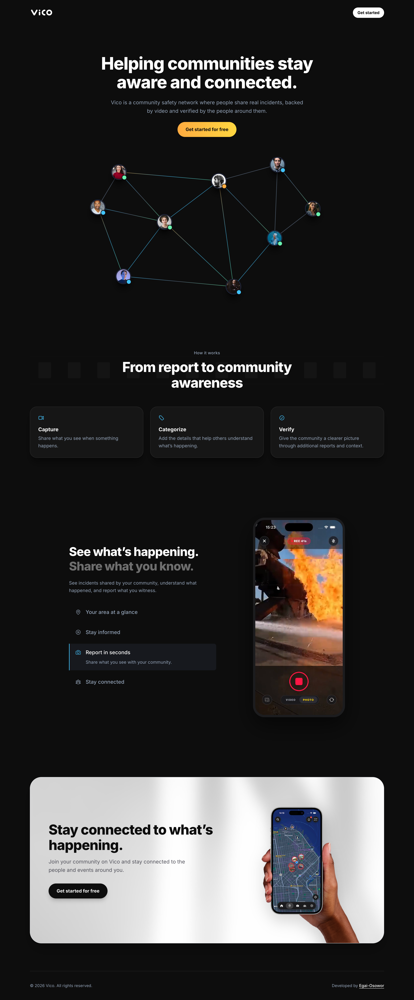

# Vico — Neighborhood Safety, Verified on Video

A modern, high-performance landing page for **Vico**, a community safety network where neighbors share real incidents backed by video and verified by the people around them.

Built with [Astro](https://astro.build/) and [Tailwind CSS v4](https://tailwindcss.com/).

---

## 📸 Preview

<p align="center">
  
</p>

---

## ✨ Features

- **Hero & Network Visualization**: Interactive community connection visualizer illustrating neighborhood mesh safety.
- **How It Works Workflow**: Clean 3-step progression:
  1. **Capture**: Share what you see as soon as something happens.
  2. **Categorize**: Add details to help neighbors understand the situation.
  3. **Verify**: Build community context through additional reports and validation.
- **Interactive Feature Showcase**: Scroll-driven phone mockup with tab switching and auto-playing demo video/screenshots:
  - **Radar**: Area at a glance with incident markers and trusted circles.
  - **Video-first**: Incident reels and live local updates.
  - **Report in seconds**: Direct video recording and immediate community broadcasting.
  - **Circles**: Stay connected to family and trusted neighbors.
- **Engaging Call-to-Action**: Responsive bottom banner featuring app preview and quick start links.
- **Dark Mode Aesthetic**: Sleek obsidian backdrop with custom gold accents, subtle gradients, and glassmorphic card elements.

---

## 🛠️ Tech Stack

- **Framework**: [Astro 5](https://astro.build/)
- **Styling**: [Tailwind CSS v4](https://tailwindcss.com/) with `@tailwindcss/vite`
- **Language**: TypeScript
- **Icons**: Custom SVG / Heroicons outline
- **Media**: Optimized WebM/MP4 video clips & web imagery

---

## 🚀 Getting Started

### Prerequisites

Ensure you have [Node.js](https://nodejs.org/) (v18.17.1 or higher) installed on your machine.

### Installation

1. Clone the repository:

   ```bash
   git clone <repository-url>
   cd vico-landing
   ```

2. Install dependencies:
   ```bash
   npm install
   ```

### Development

Run the local development server:

```bash
npm run dev
```

The site will be available at `http://localhost:4322/`.

### Production Build

Build the static site for production deployment:

```bash
npm run build
```

Preview the production build locally:

```bash
npm run preview
```

---

## 📁 Project Structure

```text
vico-landing/
├── public/
│   └── assets/             # Video clips, logos, screenshots, mockups
├── src/
│   ├── components/
│   │   ├── home/           # Hero, HowItWorks, Features, CTA, HeroNetwork
│   │   └── layout/         # Header, Footer, Logo
│   ├── data/               # Feature data & schemas
│   ├── layouts/            # Base HTML layout & meta tags
│   ├── pages/              # Main index route
│   └── styles/             # Global Tailwind CSS styles
├── astro.config.mjs        # Astro configuration
├── package.json
└── tsconfig.json           # TypeScript configuration
```

---

## 📄 License

Private / All rights reserved.
